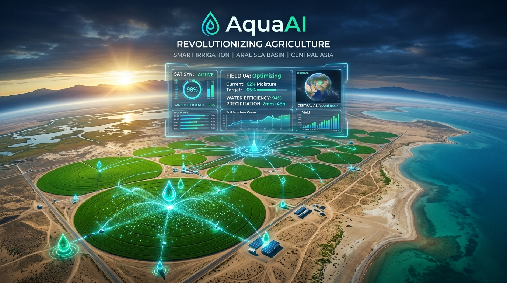
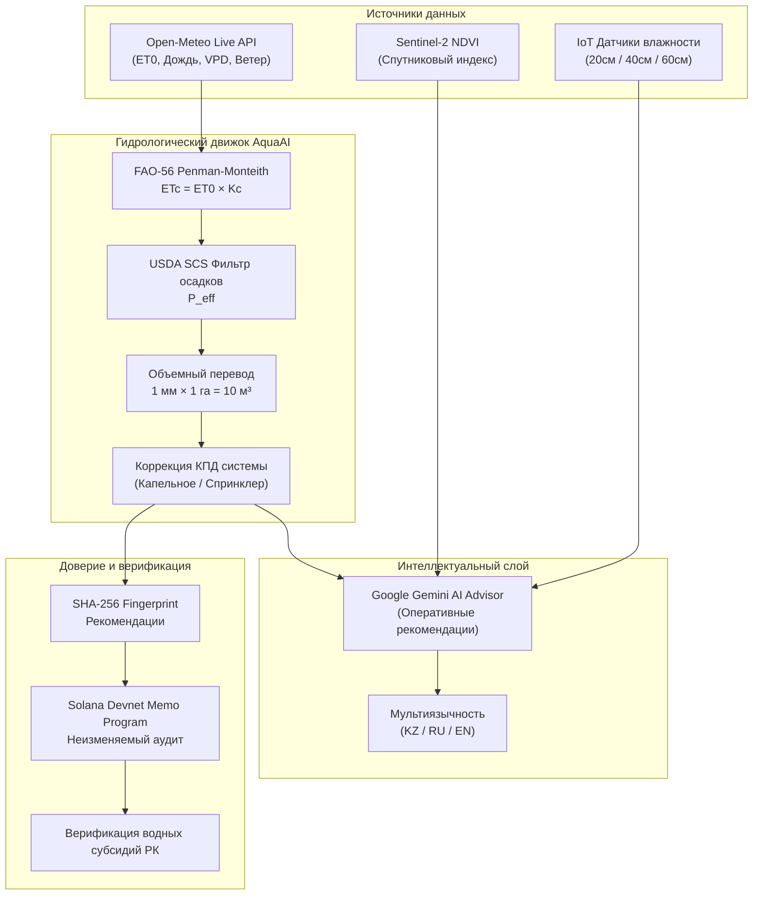

<p align="center">
  
</p>

# 🌊 AquaAI — AI-Powered Smart Irrigation Platform
### *Combating Agricultural Water Waste in Central Asia & the Aral Sea Basin*

<p align="center">
  <a href="https://github.com/SalaAkh/AquaAI/actions/workflows/ci.yml">
    
  </a>
  <a href="https://vercel.com/new/clone?repository-url=https%3A%2F%2Fgithub.com%2FSalaAkh%2FAquaAI&project-name=aqua-ai&root-directory=aqua-app">
    
  </a>
  <a href="https://app.netlify.com/start/deploy?repository=https://github.com/SalaAkh/AquaAI">
    
  </a>
  <a href="LICENSE">
    
  </a>
  <a href="https://nextjs.org/">
    
  </a>
  <a href="https://react.dev/">
    
  </a>
  <a href="https://solana.com/">
    
  </a>
</p>

---

> **🏆 Конкурс стартапов IDEA MINERS 2026 / Colosseum Hackathon MVP**  
> *Smarter Irrigation. Every Drop Counts. | Умный полив. Каждая капля на счету. | Ақылды суару. Әрбір тамшы маңызды.*

---

## ⚡ Быстрые ссылки / Quick Links

- 📋 **[Материалы для IDEA MINERS 2026 (Pitch Deck, Скрипты, Ответы жюри)](docs/IDEA_MINERS_SUBMISSION.md)**
- 🗄️ **[Руководство по настройке Supabase PostgreSQL (RLS)](docs/SUPABASE_SETUP.md)**
- 🚀 **[Развернуть в 1 клик на Vercel (Production)](https://vercel.com/new/clone?repository-url=https%3A%2F%2Fgithub.com%2FSalaAkh%2FAquaAI&project-name=aqua-ai&root-directory=aqua-app)**
- 🎬 **[Материалы питча и медиа (Media Hub)](media/pitch/README.md)**
- 📁 **[Репозиторий GitHub](https://github.com/SalaAkh/AquaAI)**
- 📑 **[Архитектура и формулы FAO-56](#-научный-агрономический-движок-fao-56)**

---

## 🎯 Проблема: Водный кризис Аральского бассейна

В бассейне Аральского моря в Центральной Азии (Казахстан, Узбекистан, Туркменистан) **более 80% забора пресной воды** расходуется на орошаемое земледелие.
- 🔴 **До 50% воды теряется** в земляных арыках из-за поверхностного испарения и глубокой фильтрации.
- 🔴 Календарный неконтролируемый полив приводит к **вторичному засолению почв** и падению урожайности.
- 🔴 Избыточный забор воды из рек Сырдарья и Амударья угрожает экосистеме Северного Аральского моря.

**AquaAI** решает эту проблему, объединяя строгую агрономическую гидрологию **FAO-56**, 7-дневные прогнозы **Open-Meteo**, искусственный интеллект **Google Gemini** и прозрачный аудит субсидий на **Solana Devnet**.

---

## 🌟 Ключевые возможности платформы

### 1. 🧮 Научный агрономический движок FAO-56
- **Уравнение Пенмана-Монтейса**: точный расчет суточного испарения культуры:
  $$ET_c = ET_0 \times K_c$$
  где $ET_0$ — эталонное испарение (мм/сутки), $K_c$ — коэффициент фазы вегетации культуры.
- **Фильтрация эффективных осадков ($P_{eff}$)** по методике USDA SCS / FAO.
- **Объемный перевод**: строгое физическое соответствие:
  $$1\text{ мм глубины} \times 1\text{ га площади} = 10\text{ м}^3\text{ воды}$$
- **Коррекция на метод орошения**: учет КПД системы (капельное: 90%, спринклеры: 75%, бороздковой полив: 50–60%).

### 2. 🌤️ Живой метеопрогноз Open-Meteo
- Интеграция с физической численной моделью прогнозирования погоды Open-Meteo.
- 7-дневный почасовой и суточный трекинг $ET_0$, осадков, дефицита упругости водяного пара (VPD), влажности, солнечной радиации и скорости ветра для регионов Туркестан, Алматы, Шымкент, Кызылорда.

### 3. 🧠 AI-Агроном Google Gemini
- Генерация понятных оперативных инструкций для фермера на государственном и русском языках.
- Алгоритм подсказывает оптимальные часы пуска насосов (ночной полив для минимизации испарения), оценку экономии и рисков болезней.

### 4. ⛓️ Неизменяемый криптоаудит Solana Devnet
- Каждая рекомендация по поливу получает криптографический отпечаток SHA-256.
- Запись в блокчейн Solana через транзакцию **Solana Memo Program** без раскрытия конфиденциальных координат фермера.
- Готовая база для верификации "зеленых" водных субсидий Министерства водных ресурсов и ирригации РК.

### 5. 🛰️ Спутниковый мониторинг Sentinel-2 NDVI и IoT-сенсоры
- Проверка индекса вегетации растений NDVI (0.0 — 1.0) для раннего обнаружения водного стресса.
- Поддержка виртуальных IoT датчиков влажности почвы (20 см, 40 см, 60 см).

### 6. 🌐 Локализация для Центральной Азии
- Полная трехъязычная поддержка: **Қазақша**, **Русский**, **English**.

---

## 🗺️ Демо-профили хозяйств Центральной Азии

| Поле / Локация | Культура | Площадь | Метод полива | Тип почвы | Экономия воды с AquaAI |
| :--- | :--- | :--- | :--- | :--- | :--- |
| **Туркестанский хлопковый бассейн** | Хлопчатник (Cotton) | 45 га | Капельное (Drip 90%) | Серозём (Silty Loam) | **~38%** vs традиционный арык |
| **Жетысуйская равнина (Алматы)** | Озимая пшеница (Wheat) | 120 га | Круговой спринклер (75%) | Каштановая почва | **~31%** vs календарный график |
| **Кастомное поле фермера** | На выбор (кукуруза, томаты, люцерна...) | Любая (га) | Настраиваемый КПД | Любой тип почвы | Автоматический расчет |

---

## 🏛️ Архитектура системы



---

## 🚀 Как запустить сайт онлайн (Deployment Options)

### Вариант 1: Развертывание в 1 клик на Vercel (Самый быстрый и надежный способ)

[](https://vercel.com/new/clone?repository-url=https%3A%2F%2Fgithub.com%2FSalaAkh%2FAquaAI&project-name=aqua-ai&root-directory=aqua-app)

1. Нажмите на кнопку выше.
2. Войдите в свой аккаунт Vercel (через GitHub).
3. Vercel автоматически клонирует репозиторий, настроит корневую директорию `aqua-app`, соберет проект и выдаст вам публичный SSL-домен (например, `https://aqua-ai.vercel.app`).
4. *(Опционально)* Добавьте переменные окружения:
   - `GEMINI_API_KEY`: ваш ключ Gemini (если не указан, работает детерминированный движок).
   - `NEXT_PUBLIC_SOLANA_RPC`: `https://api.devnet.solana.com`.

---

### Вариант 2: Бесплатный деплой на Netlify

[](https://app.netlify.com/start/deploy?repository=https://github.com/SalaAkh/AquaAI)

Конфигурационный файл [`netlify.toml`](netlify.toml) уже настроен в репозитории.

---

### Вариант 3: Развертывание в Firebase (Google Cloud)

Проект полностью настроен для запуска в **Firebase Hosting** и **Firebase App Hosting**:
- Конфигурации: [`firebase.json`](firebase.json) и [`aqua-app/apphosting.yaml`](aqua-app/apphosting.yaml).
- Поддержка Next.js SSR и API-роутов через Google Cloud Run / Functions.

#### Способ А: Через консоль Firebase App Hosting (Без терминала)
1. Откройте [Firebase Console](https://console.firebase.google.com/) и создайте или выберите проект.
2. В левом меню выберите **Build** ➔ **App Hosting** (или **Hosting**).
3. Нажмите **Get Started** и подключите GitHub-репозиторий `SalaAkh/AquaAI` (корневая папка `aqua-app`).
4. Firebase автоматически соберет и опубликует сайт с глобальным CDN и SSL.

#### Способ Б: Через Firebase CLI
```bash
# 1. Авторизация в Google Firebase (откроется окно браузера)
npm run firebase:login

# 2. Выбор или создание проекта
npx firebase-tools use --add

# 3. Деплой сайта
npm run firebase:deploy
```

---

### Вариант 4: Запуск в Docker контейнере

```bash
# Сборка production контейнера
docker build -t aqua-ai .

# Запуск на порту 3000
docker run -d -p 3000:3000 --name aqua-ai-prod aqua-ai
```
Сайт будет доступен по адресу: `http://localhost:3000`.

---

### Вариант 5: Локальная разработка и тестирование

```bash
# 1. Клонирование репозитория
git clone https://github.com/SalaAkh/AquaAI.git
cd AquaAI/aqua-app

# 2. Воспроизводимая чистая установка зависимостей
npm ci

# 3. Запуск тестов (Unit FAO-56 + Integration)
npm test

# 4. Проверка статической типизации TypeScript
npm run typecheck

# 5. Production сборка Next.js
npm run build

# 6. Запуск сервера разработки
npm run dev
```

Откройте [http://localhost:3000](http://localhost:3000) в браузере.

---

## 🧪 Комплексное тестирование

В проекте реализована трехуровневая система тестов:
1. **Гидрологические тесты FAO-56 (`tests/fao56.test.mjs`)**:
   - Формулы $ET_c = ET_0 \times K_c$, эффективные осадки, перевод глубин в объём (1 мм × 1 га = 10 м³).
   - Расчёт подачи насоса ($м^3 = Q \times t$), дельта расходомера, экстремальная жара и перелив.
2. **Интеграционные тесты (`tests/integration.test.mjs`)**:
   - Авторизация, CRUD хозяйств и полей, спецификации насосов.
   - Учёт расхода воды (все 3 метода), план-факт отклонения, пользовательские тарифы.
   - Схема и дисклеймеры AI-агронома.
3. **Сквозной жизненный цикл E2E (`tests/test_e2e_journey.mjs`)**:
   - 10-этапная симуляция пути фермера от создания поля до выгрузки ROI.

---

## 📦 Стек технологий

- **Фреймворк**: [Next.js 16 (App Router)](https://nextjs.org/) & [React 19](https://react.dev/)
- **Язык**: [TypeScript 5](https://www.typescriptlang.org/)
- **Стилизация**: [Tailwind CSS 4](https://tailwindcss.com/) + Custom Glassmorphism Design System
- **Метеорология**: [Open-Meteo Free Weather API](https://open-meteo.com/)
- **Искусственный интеллект**: [Google Gemini Pro / Flash API](https://ai.google.dev/)
- **Блокчейн**: [Solana Web3.js](https://solana.com/) & Memo Program (Devnet)
- **Иконки**: [Lucide React](https://lucide.dev/)
- **CI/CD**: GitHub Actions, Vercel, Netlify, Docker

---

## 📄 Лицензия

Распространяется под лицензией MIT. Подробнее см. в файле [LICENSE](LICENSE).

---

<p align="center">
  <b>AquaAI</b> — Сохраним водное будущее Центральной Азии вместе. 💧🇰🇿
</p>
